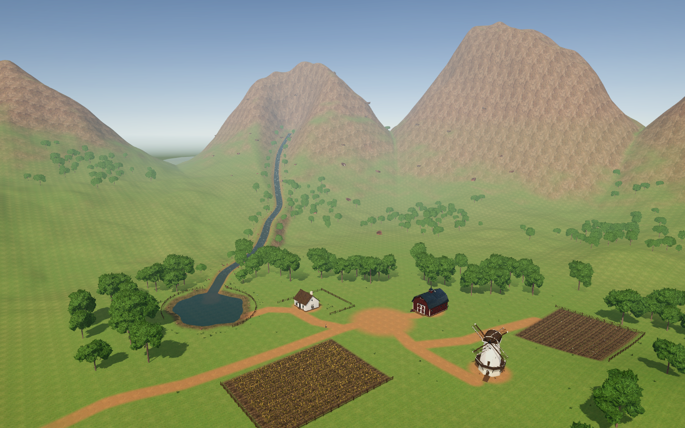
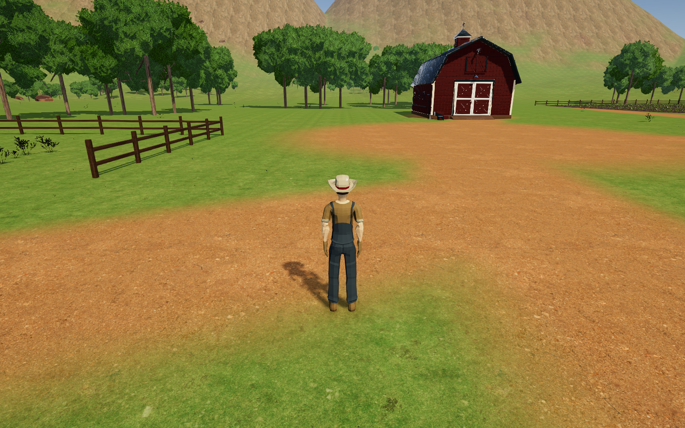

# Granja interactiva

Proyecto de **Computación Gráfica** desarrollado en **Unity 6**. Representa una granja que se puede recorrer con un avatar: casa, granero, molino, cultivos y caminos, dentro de un valle con montañas, vegetación y un río que desemboca en un lago.



## Abrir y ejecutar

| Requisito | Versión |
| --- | --- |
| Unity Editor | **6000.6.3f1** |
| Universal Render Pipeline | 17.6.0 |
| Input System | 1.20.0 |

1. Clona o descarga este repositorio.
2. En **Unity Hub**, añade la carpeta raíz del proyecto, donde están `Assets`, `Packages` y `ProjectSettings`.
3. Ábrelo con la versión de Unity indicada. Los paquetes se resuelven desde `Packages`.
4. Abre la escena [TerrenoCiudad.unity](Assets/Granja/Escenas/TerrenoCiudad.unity).
5. Pulsa **Play** y haz clic en la ventana **Game** para utilizar el teclado.

## Controles

| Tecla o acción | Resultado |
| --- | --- |
| **W · A · S · D** | Caminar en relación con la orientación de la cámara. |
| **Shift + WASD** | Correr a 5 m/s; la marcha normal es de 1,8 m/s. |
| **E** | Saludar. El personaje se detiene durante el gesto y después recupera el control. |
| **Botón derecho + ratón** | Girar la cámara alrededor del personaje. |




## Componentes del escenario

| Elemento | Construcción y funcionamiento |
| --- | --- |
| **Terreno de la granja** | `Terrain` de 400 × 400 m y `Terrain Collider`. Relieve, caminos, orillas y parcelas guardados en `Granja_natural.asset`. Siete `Terrain Layers` mezclan pradera, tierra, roca y grava. |
| **Montañas y valle** | Segundo `Terrain` de 1600 × 1600 m, guardado en `Sierra_y_valle.asset`. Se integra con el borde del terreno principal. |
| **Casa y granero** | Modelos adaptados como prefabs, con `Mesh Filter`, `Mesh Renderer` y colisión. Materiales de madera, revoco, tejas y cristal. |
| **Molino** | Cuerpo fijo con `Mesh Collider` y aspas independientes. El pivote está en el eje y las aspas giran a 6°/s, una vuelta por minuto. |
| **Cultivos y caminos** | Parcelas de trigo y plantas de hoja, surcos y caminos de tierra que siguen el relieve. Las plantas de hoja reutilizan el modelo de helecho. |
| **Vegetación y rocas** | Prefabs repetidos con variaciones de posición, giro y escala. Árboles con tres niveles de detalle (`LOD Group`) y hierba agrupada en mallas. |
| **Río y lago** | Cauce excavado y superficies de agua hechas con mallas. Un shader anima ondas y espuma; el movimiento se suaviza al llegar al lago. Ambas superficies comparten color y ondas para dar continuidad al agua. |
| **Vallas** | Postes y travesaños de madera con colisión, con accesos a las distintas zonas y una abertura en la desembocadura. |
| **Granjero** | `Character Controller`, `Animator` con rig `Generic` y animaciones **Neutral, Walk, Run y Wave**. `Root Motion` desactivado: el script controla el desplazamiento. |
| **Cámara** | Seguimiento del avatar, giro con el ratón y acercamiento automático cuando encuentra un obstáculo. |
| **Iluminación** | Luz direccional con sombras suaves, cielo diurno, reflejos y ajustes de URP, como oclusión ambiental y tonemapping ACES. |

## Organización del proyecto

```text
Assets/
├── Granja/
│   ├── Escenas/              # Escena principal: TerrenoCiudad
│   ├── Entorno/
│   │   ├── Materiales/
│   │   ├── Modelos/          # Mallas del escenario
│   │   ├── Prefabs/
│   │   ├── RecursosExternos/ # Texturas y recursos importados utilizados
│   │   ├── Scripts/          # Giro del molino
│   │   ├── Shaders/          # Agua y terreno
│   │   ├── Terreno/          # TerrainData y Terrain Layers
│   │   └── Texturas/
│   └── Personaje/
│       ├── Animaciones/      # Animator Controller
│       ├── Materiales/
│       ├── Modelos/          # Farmer y sus animaciones
│       ├── Prefabs/
│       └── Scripts/         # Movimiento y cámara
└── Settings/                # Configuración gráfica e Input System
Packages/                    # Dependencias y versiones
ProjectSettings/             # Ajustes de Unity y escena de compilación
docs/imagenes/               # Capturas del proyecto
Licencias/                   # Avisos de los recursos de terceros
```

## Código principal

| Archivo | Responsabilidad |
| --- | --- |
| [MovimientoGranjero.cs](Assets/Granja/Personaje/Scripts/MovimientoGranjero.cs) | Lee WASD, Shift y E; aplica movimiento, giro y gravedad; comunica la velocidad y el saludo al Animator. |
| [CamaraGranjero.cs](Assets/Granja/Personaje/Scripts/CamaraGranjero.cs) | Sigue al personaje y controla el giro y las colisiones de la cámara. |
| [RotarAspasMolino.cs](Assets/Granja/Entorno/Scripts/RotarAspasMolino.cs) | Gira las aspas con `Time.deltaTime` para mantener una velocidad independiente de los fotogramas. |
| [AguaCorriente.shader](Assets/Granja/Entorno/Shaders/AguaCorriente.shader) | Anima las ondas y la espuma, y une visualmente el río con el lago. |

Los shaders de terreno mate son adaptaciones del **Terrain Lit de Unity URP 17.6.0** que desactivan los reflejos especulares del suelo.

## Recursos y créditos

El proyecto combina trabajo de montaje, configuración, adaptación de materiales y programación con **modelos, animaciones y texturas de terceros**.

| Proveedor | Recursos utilizados | Licencia |
| --- | --- | --- |
| **Quaternius / Poly Pizza** | [Farmer](https://poly.pizza/m/7pn3R6hPvE), con sus animaciones y paleta adaptada a URP. | CC0 |
| **Grab3D** | [Cottage House](https://grab3d.com/models/buildings/cottage-house/), [Barn](https://grab3d.com/models/buildings/barn/) y [Windmill](https://grab3d.com/models/buildings/windmill/), adaptados para la granja. | [CC0 y aviso del proveedor](Licencias/Grab3D_CC0.txt) |
| **Poly Haven** | Vegetación, rocas, texturas de superficies y cielo. | [CC0](https://polyhaven.com/license) |
| **Unity Technologies** | Shaders de terreno de URP, adaptados para el aspecto mate. | [Licencia de Unity URP](Licencias/Unity_URP.txt) |
| **UnityMeshSimplifier**, Mattias Edlund | Herramienta utilizada durante la preparación para simplificar las mallas del árbol. | [MIT](Licencias/UnityMeshSimplifier_MIT.txt) |

<details>
<summary><strong>Ver los recursos de Poly Haven y su autoría</strong></summary>

Powered by Poly Haven.

| Modelo | Autoría publicada |
| --- | --- |
| [Tree Small 02](https://polyhaven.com/a/tree_small_02) | Rico Cilliers |
| [Wild Rooibos Bush](https://polyhaven.com/a/wild_rooibos_bush) | James Ray Cock y Jenelle van Heerden |
| [Grass Bermuda 01](https://polyhaven.com/a/grass_bermuda_01) | Rico Cilliers |
| [Rock 07](https://polyhaven.com/a/rock_07) | Jenelle van Heerden |
| [Fern 02](https://polyhaven.com/a/fern_02) | Rob Tuytel y Rico Cilliers |
| [Flower Gazania](https://polyhaven.com/a/flower_gazania) | James Ray Cock y Jenelle van Heerden |

Texturas: [Grass Ground](https://polyhaven.com/a/grass_ground);
[Grass Path 3](https://polyhaven.com/a/grass_path_3);
[Gravelly Sand](https://polyhaven.com/a/gravelly_sand);
[Rock Face 03](https://polyhaven.com/a/rock_face_03), de Dario Barresi y Rico Cilliers;
[Brown Mud 03](https://polyhaven.com/a/brown_mud_03);
[Roof Tiles 14](https://polyhaven.com/a/roof_tiles_14);
[White Plaster Rough 02](https://polyhaven.com/a/white_plaster_rough_02);
[Weathered Plank Siding](https://polyhaven.com/a/weathered_plank_siding);
[Weathered Brown Planks](https://polyhaven.com/a/weathered_brown_planks).

Cielo: [Kloofendal 48d Partly Cloudy](https://polyhaven.com/a/kloofendal_48d_partly_cloudy).

</details>

## Archivos del repositorio

Se conservan los archivos `.meta` junto a sus recursos para mantener las referencias de Unity. `.gitignore` excluye las cachés, registros, ajustes personales, archivos generados del IDE y copias locales. Unity recrea estos archivos al abrir el proyecto.
